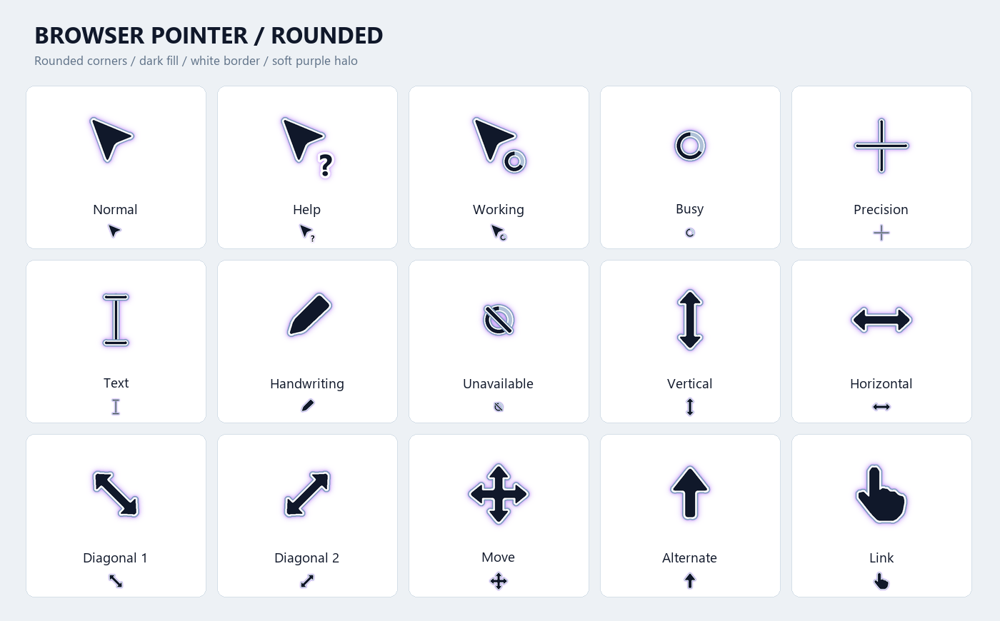

# Browser Pointer Rounded

A rounded cursor theme for **Windows and macOS**: dark pointers, soft corners, a white border and a fine blue edge. Includes installers, animated busy cursors and restore instructions.

**[Download for Windows](https://github.com/mnikoie/browser-pointer-rounded/releases/latest/download/Browser-Pointer-Rounded-Windows.zip)** · **[Download for Mac — PKG](https://github.com/mnikoie/browser-pointer-rounded/releases/latest/download/Browser-Pointer-Rounded-macOS.pkg)** · **[Mac ZIP](https://github.com/mnikoie/browser-pointer-rounded/releases/latest/download/Browser-Pointer-Rounded-macOS.zip)** · **[فارسی](#فارسی)**



## Download

Use the files in [Releases](https://github.com/mnikoie/browser-pointer-rounded/releases/latest). Download the installer for your operating system; GitHub's **Code → Download ZIP** contains source files rather than the packaged release.

- **Windows:** extract `Browser-Pointer-Rounded-Windows.zip` and run `Install.cmd`. Use `Restore.cmd` to restore your previous configuration.
- **macOS 14+:** extract `Browser-Pointer-Rounded-macOS.zip`, then double-click `Install.command`. It downloads Mousecape from its upstream release, verifies the SHA-256, and opens the cape. Select **Browser Pointer Rounded → Apply** in Mousecape.
- **macOS PKG:** install the PKG, then open **Browser Pointer Rounded** in Applications to run the setup above. A DMG contains the same PKG.

For persistence on macOS, enable **Launch at Login** in Mousecape settings. To reset, use Mousecape's **File → Reset System Cursor** and turn off the login option if no longer needed. `Restore.command` opens the app and explains these steps; it does not silently delete other themes.

The macOS installer uses [Mousecape SwiftUI](https://github.com/sdmj76/Mousecape-swiftUI), downloaded separately rather than redistributed. It keeps normal macOS security checks enabled. The PKG is not Developer ID signed or notarized; the launcher bundle has an ad-hoc integrity signature. No Apple credentials are included.

## Contents and validation

Windows contains 15 CUR roles (32, 48, 64 and 96 pixel resources) plus two animated ANI alternatives. The Windows assets were accepted by the native Windows cursor loader.

macOS contains 14 corresponding roles mapped to 39 cursor identifiers, including ArrowS/IBeamS aliases. PNG strips provide 1x, 2x and 3x representations, and 12 frames for busy/working animations. macOS has no corresponding general-purpose Windows handwriting role; Copy, Alias, grab hands and other specialized Mac roles keep their defaults.

`tools/validate_macos.py` verifies plist contents, PNG dimensions and alpha, hotspot bounds and animation diversity. GitHub Actions validates the cape and shell syntax on a macOS runner and builds the PKG/DMG. These checks do not replace interactive testing of cursor appearance in applications; actual activation has not been tested on a personal Mac.

## Rebuild the macOS cape

```sh
python -m pip install Pillow==12.3.0
python tools/build_macos.py
python tools/validate_macos.py
```

The geometry source is `tools/artwork.py`. Mousecape format and cursor identifiers were checked against upstream `MCDefs.m` and `apply.m`. No third-party Mousecape source or executable is bundled here.

## Feedback

[Report a problem](https://github.com/mnikoie/browser-pointer-rounded/issues/new?template=bug_report.yml) or [suggest a change](https://github.com/mnikoie/browser-pointer-rounded/issues/new?template=feature_request.md). Include your operating system version, cursor role, display scaling and a screenshot when relevant. Reports in Persian and English are welcome. See [CONTRIBUTING.md](CONTRIBUTING.md) for artwork and validation instructions.

## فارسی

پک نشانگر با گوشه‌های گرد برای ویندوز و مک، همراه نصب‌کننده و حالت انتظار متحرک.

- **ویندوز:** [دانلود ZIP ویندوز](https://github.com/mnikoie/browser-pointer-rounded/releases/latest/download/Browser-Pointer-Rounded-Windows.zip)، استخراج و اجرای `Install.cmd`. بازگشت به نشانگر قبلی با `Restore.cmd`.
- **مک ۱۴ و جدیدتر:** [دانلود نصب‌کننده PKG](https://github.com/mnikoie/browser-pointer-rounded/releases/latest/download/Browser-Pointer-Rounded-macOS.pkg)، نصب و اجرای **Browser Pointer Rounded** از Applications؛ سپس انتخاب پک و زدن **Apply** در Mousecape.
- **راهنمای کامل مک:** [نصب و بازگردانی](macOS/README-fa.txt).
- **گزارش مشکل یا پیشنهاد:** [Issues](https://github.com/mnikoie/browser-pointer-rounded/issues). لطفاً نسخه سیستم‌عامل و اندازه نمایشگر یا درصد مقیاس را بنویسید.
